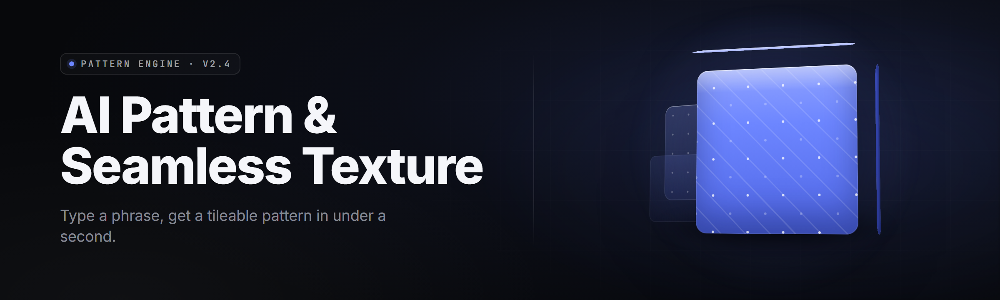

  
  
  

  

  
  
  

---

**Diffusion-backed tile synthesis for game artists, modders, and texture pack authors — 2026**

*From prompt to production-ready, edge-matched PBR set in under a minute.*

---

## 📋 Compatibility

| Game / Engine | Tiling Support | Normal Schema | Import Path | Notes |
|---|---|---|---|---|
| Unreal Engine 5.x | Native | DirectX (Y−) | `/Content/Textures` | Nanite-safe BC7 export |
| Unity 6 LTS | Native | OpenGL (Y+) | `/Assets/StreamingAssets` | Auto-imports as DXT5nm |
| Godot 4.4 | Native | OpenGL (Y+) | `res://textures/` | 4K RGBA8 supported |
| Source 2 (CS2 / HL:X) | Native | DirectX (Y−) | `materials/` | VTF/VMT pair writer |
| Blender 4.4 | Add-on bridge | Both | Clipboard / file | Cycles preview mirror |
| Skyrim / FO4 (BA2) | Community | DirectX (Y−) | `.dds` → archive | Powers of two only |
| Roblox Studio | Manual | OpenGL (Y+) | ImageId upload | Watched-folder sync |
| Generic canvas / web | Native | Configurable | PNG/TGA/WebP | Alpha-safe borders |

---

## 🗺️ Table of Contents

- [Overview](#overview)
- [What Is an AI Seamless Texture Generator?](#what-is-an-ai-seamless-texture-generator)
- [Key Features](#-key-features)
- 

  

(#-download)
- [The Problem](#-the-problem)
- [The Solution](#-the-solution)
- [Quick Start](#-quick-start)
- [Comparison](#-comparison)
- [Inpainting & Tiling Engine](#-inpainting--tiling-engine)
- [PBR Material Pipeline](#-pbr-material-pipeline)
- [Prompt & Style Control](#-prompt--style-control)
- [Batch & Automation](#-batch--automation)
- [Texture Editing Toolkit](#-texture-editing-toolkit)
- [System Requirements](#-system-requirements)
- [Installation](#-installation)
- [Known Issues](#-known-issues)
- [FAQ](#-faq)
- [Usage Guidelines](#-usage-guidelines)

---

## 🔍 Overview

The AI Pattern & Seamless Texture Generator is a Windows `.exe` that turns a prompt, a photo, or a rough sketch into a tiling, physically-based material set. Edges match across every seam. Roughness, normal, height, and AO maps come out coherent — not bolted on after the fact. It ships with a local diffusion backend, so once the model is cached, generation runs offline at full VRAM speed.

| Category | Details |
|---|---|
| Core engine | Latent diffusion + tiled inpainting solver |
| Output formats | PNG, TGA, DDS (BC7/BC5), WebP, VTF |
| Resolution range | 128×128 up to 8192×8192 |
| Map stack | Albedo, Normal, Roughness, Height, AO, Metalness, Emissive |
| Batch capacity | 512 jobs / queue, non-blocking GPU scheduler |
| Presets | 87 built-in material archetypes |
| Runtime | Self-contained `.exe`, no external Python/npm |
| Cache | Local model vault under `%LOCALAPPDATA%` |

Everything a texture author needs sits behind one window: prompt, seed, tiling constraint, export target, done.

---

## 📖 What Is an AI Seamless Texture Generator?

| Term | Explanation |
|---|---|
| Seamless tiling | A texture whose left/right and top/bottom edges match pixel-perfect when repeated, with no visible grid. |
| Edge warp | A solver pass that shifts the boundary ring inward so diffusion can blend across the seam. |
| PBR stack | Physically-Based Rendering maps (albedo, normal, roughness, height, AO, metal, emissive) that describe how light hits a surface. |
| Latent diffusion | A generative model that denoises in a compressed latent space, then decodes back to pixels. |
| Inpaint mask | The region the model repaints — here, a reflected border band driven by the tile edges. |
| Normal map | A per-pixel RGB texture that fakes surface relief direction; schema (Y+/Y−) matters per engine. |
| Seed lock | Fixing the stochastic seed so a re-run produces the identical material set for iteration. |

**Why artists keep coming back to it:**

- Tiling is enforced at generation time, not patched in a post-process that leaves a visible grid at 4K.
- The PBR stack is consistent — the normal map actually matches the albedo relief.
- It reads your engine's normal schema and exports the right DDS/VTF without a round trip.
- Prompt-only generation, photo-to-tile, and sketch-to-tile all share the same pipeline.
- Runs local after first model pull — no per-pixel cloud billing.

---

## 🧩 Key Features

| Feature | Description | Benefit |
|---|---|---|
| Seam solver v3 | Reflects the border band and inpaints it against the core | Zero visible seam at any zoom |
| Multi-map generation | Albedo → normal → roughness → height → AO in one pass | Coherent PBR, no manual derivation |
| Engine presets | VTF, DDS BC7/BC5, Unity DXT5nm, GL Y+ flip | Import-ready files, zero fixup |
| Photo-to-tile | Drop a real photo, get a tiling material | Turns reference to asset in seconds |
| Sketch-to-tile | Draw rough shapes, model fills material detail | Concept-art-driven authoring |
| Prompt batcher | Queue hundreds of variations from a CSV | Pack-scale output overnight |
| Seed lock / replay | Reproducible sets for iterative tuning | Version your texture recipes |
| Live tiling preview | 6×6 grid preview updates as you tweak | Judge the seam before export |
| Channel splitter | Isolate any map channel to a grayscale doc | Comp-only workflows |
| Warp controls | Strength, radius, direction of the edge warp | Hand-tune hard materials vs organic |
| Height-to-normal | Derive normal from height, tangent-accurate | One source, two maps |
| Normal-to-height | Solve height from an existing normal map | Reconstruct legacy assets |
| Metalness assist | Prompt-driven metal regions with masks | Injected detail on hard surfaces |
| Emissive map | Glow channel derived from prompt keywords | Neon/runes/sci-fi signage |
| Tiling asymmetry pass | Optional variance across quadrants | Breaks the "too perfect" look |
| Curve-based edge blend | Smoothstep control on seam falloff | Organic grass, fabric, bark |
| Style lock | CLIP-guided style anchors across a batch | Consistent pack identity |
| Concept paste | Paint a quick region mask, model respects it | Directed composition |
| Deterministic variant list | N variants from one prompt, saved as table | Fast pick-and-ship choice |
| Tag auto-caption | BLIP-style auto-caption from selected region | Skip typing prompts |
| Console / CLI mode | Headless generation for CI and pipelines | CI-authored texture builds |
| Watched folder sync | Drop prompt, files appear in engine folder | Roblox/Unity live loops |
| GPU scheduler | VRAM-aware job queue, low-memory mode | Runs on 8 GB cards, no OOM |
| Tiled 8K stitcher | Generate tiles for a big canvas, stitch seamlessly | 8K materials on 6 GB cards |
| Downsample/Normalize | Pyramid export + power-of-two enforce | Console compliance |
| Upscale refine | 2× refine pass with edge-aware blur | Clean 4K from 2K drafts |
| Diff viewer | Side-by-side before/after compare | Catch regressions before ship |
| Undo stack (10 steps) | Every destructive op reversible | Safe experimentation |
| Palette lock | Fix a color range across a set | Brand-consistent tile packs |
| Pattern rotator | Rotate pattern in 90° steps and re-solve seams | Axis-variant materials from one prompt |
| Tile density ruler | Visualize tile repeats on a plane | Match in-game texel density |

---

## ⬇️ Download

  

---

## 🧱 The Problem

- Post-process tiling tools (offset + clone stamp) leave a soft grid that shows at 4K on rigid geometry.
- Deriving normal / roughness / AO by hand from one albedo never lines up with the actual relief.
- Exporting to Source 2, Unity, and Unreal from one texture means three separate normal-flip and format steps.
- Reference photos look great as a square but break the second you tile them on a floor plane.
- Batch material generation lives behind Python scripts that fight CUDA versions and venvs.
- Consistent pack identity across 200 tiles is guesswork — every prompt drifts the palette and style.

## 🧪 The Solution

| Problem | Solution |
|---|---|
| Visible grid at high res | Seam solver runs at generation time, not as a post filter |
| Mismatched PBR maps | Single-pass multi-map generation keeps relief coherent |
| Per-engine format churn | Engine presets write VTF/DDS/PNG with the right schema |
| Photo sources break tiling | Photo-to-tile pipeline edge-warps before inpainting |
| No environment to run it | Self-contained `.exe`, model cached under `%LOCALAPPDATA%` |
| Inconsistent pack identity | Style lock + palette lock hold CLIP and color across a batch |

---

## 🚀 Quick Start

1. 🎯 Visit the project landing page and hit **Download**.
2. 📦 Extract the archive to a folder with write access (avoid `C:\Program Files`).
3. 🛡️ Windows will flag the unsigned `.exe` — run it from the extracted folder; allow the UAC prompt.
4. 🏃 Launch the `.exe`. On first run, allow it to pull and cache the local model (needs ~6 GB disk).
5. ⌨️ Drop a prompt, hit generate, use the live 6×6 preview to confirm the seam, then export.

**Default hotkeys:** `Ctrl+Enter` generate · `Ctrl+S` save set · `Ctrl+Shift+Q` queue batch · `F5` re-solve seam · `Tab` cycle maps · `Esc` cancel job.

---

## ⚖️ Comparison

| Aspect | Alternative post-process tools | This Tool |
|---|---|---|
| Tiling method | Offset + clone/heal after the fact | Seam solver at generation time |
| PBR stack origin | Derived from albedo (approximate) | Generated coherent in one pass |
| Engine export | Manual flip + repack | Presets write VTF / DDS BC7 / DXT5nm directly |
| Photo source | Import + hand crop | Photo-to-tile pipeline with edge warp |
| Batch | Script + venv + CUDA chase | GUI CSV queue, GPU scheduler, CLI mode |
| 8K output | Needs big VRAM | Tiled stitcher, low-memory mode |
| Reproducibility | Manual seeds noted in a doc | Seed lock + replay per set |
| Undo | App-dependent | 10-step stack on every destructive op |
| Runtime | Depends on external Python | Self-contained Windows `.exe` |

---

## 🌀 Inpainting & Tiling Engine

**Feature** — Border reflection, edge warp, directional falloff, and per-pass re-solve.

- **Reflection pad** — copies the boundary ring outward so diffusion has a context band that already matches across the seam.
- **Edge warp strength** — 0.0 to 1.0 control; low for hard materials (metal, tile, brick), high for organic (grass, fur, fabric).
- **Falloff curve** — smoothstep, cosine, or linear; visible only as a curvature in the blend region.
- **Re-solve pass** — rerun only the boundary band after a manual edit, seconds instead of a full regen.
- **Asymmetry variance** — optional quadrant drift so a tiled wall doesn't look stamped.

## 🪨 PBR Material Pipeline

**Feature** — One pass, coherent stack, engine-ready export.

- **Albedo base** — diffusion output at target resolution, optional artist override.
- **Normal from height** — tangent-space solver, schema selectable (Y+/Y−).
- **Normal from albedo (assist)** — fallback when height is unavailable.
- **Roughness** — prompt-weighted channel; keyword modifiers map to roughness bias (e.g. `wet`, `matte`, `polished`).
- **AO** — ambient occlusion derived from height peaks/valleys with strength slider.
- **Metalness / emissive** — keyword-triggered mask regions (`rust`, `neon`, `gold`, `lava`).
- **Channel splitter** — isolate any map to its own doc for comp work.

## 🎨 Prompt & Style Control

**Feature** — Prompt, negative prompt, style anchors, and palette locks.

- **Prompt box** — plain text, tag-comma friendly.
- **Negative prompt** — exclude `seam`, `grid`, `blur`, `watermark` style artifacts.
- **Style lock (CLIP)** — pick a reference tile; every job in the batch pulls toward its embedding.
- **Palette lock** — extract 3–8 colors and enforce range across a set.
- **Tag auto-caption** — region-select and let the captioner fill the prompt.
- **Preset library** — 87 archetypes across organic, mineral, industrial, sci-fi, fantasy.

## 📦 Batch & Automation

**Feature** — CSV queue, CLI mode, watched folder.

- **CSV queue** — one row per job: prompt, resolution, engine preset, seed, output path.
- **GPU scheduler** — VRAM-aware; low-memory mode tiles big canvases.
- **CLI mode** — headless generation for CI; same engine, no GUI.
- **Watched folder sync** — drop a prompt file, get a texture in the target engine folder.
- **Variant list** — N variants per prompt, saved as a sortable table.

## 🛠️ Texture Editing Toolkit

**Feature** — Small tools for the last mile.

- **Warp brush** — soft edge warp on a selected region.
- **Channel mixer** — remap any RGB channel.
- **Saturation / curves** — 1-click presets plus freehand.
- **Downsample pyramid** — power-of-two mip chain export.
- **Upscale refine** — 2× refine from a smaller draft.
- **Diff viewer** — before/after compare with a sliding split.
- **Tile density ruler** — overlay repeats on a ground plane.

## 🧮 Comparison

| Module | Status | Description |
|---|---|---|
| Seam solver v3 | ✅ Working | Generation-time tiling with edge warp |
| Multi-map generator | ✅ Working | Albedo/normal/rough/height/AO/metal/emissive |
| Engine presets | ✅ Working | VTF, DDS BC7/BC5, DXT5nm, GL Y+ flip |
| Photo-to-tile | ✅ Working | Reference image to tiling material |
| Sketch-to-tile | ✅ Working | Rough shape to material fill |
| Prompt batcher (CSV) | ✅ Working | Queue hundreds of jobs |
| GPU scheduler | ✅ Working | VRAM-aware, low-memory mode |
| Tiled 8K stitcher | ✅ Working | Big canvas via tile grid + stitch |
| Seed lock / replay | ✅ Working | Reproducible material sets |
| Channel splitter | ✅ Working | Isolate any map channel |
| Height↔Normal solver | ✅ Working | Tangent-accurate conversion, both ways |
| Metalness assist | ✅ Working | Prompt-mask region injection |
| Emissive map generator | ✅ Working | Keyword-driven glow channels |
| Style lock (CLIP) | ✅ Working | Batch-consistent style anchor |
| Palette lock | ✅ Working | Cross-set color-range enforcement |
| Auto-caption | ✅ Working | Region BLIP-style prompt fill |
| CLI / headless mode | ✅ Working | CI-friendly generation |
| Watched folder sync | ✅ Working | Auto-import into engine folder |
| Variant list | ✅ Working | N variants per prompt, sortable |
| Warp brush | ✅ Working | Manual edge-warp touching |
| Curve edge blend | ✅ Working | Smoothstep/cosine/linear falloff |
| Diff viewer | ✅ Working | Sliding before/after compare |
| Undo stack (10) | ✅ Working | All destructive ops reversible |
| Mip pyramid export | ✅ Working | Power-of-two mip chain writer |
| Pattern rotator | ✅ Working | 90° rotate + re-solve seams |
| Tile density ruler | ✅ Working | Overlay repeat on plane |
| Upscale refine pass | ✅ Working | 2× edge-aware upscaling |
| Asymmetry pass | ✅ Working | Quadrant drift to break stamping |
| Concept paste | ✅ Working | Region mask guided composition |
| Style anchor presets | 🧪 Beta | 24 anchors from community packs |
| Normal seam fuse | 🧪 Beta | Seamless normal-map fusion across tiles |

---

## 🖥️ System Requirements

| Component | Minimum | Recommended |
|---|---|---|
| OS | Windows 10 22H2 (x64) | Windows 11 24H2 |
| CPU | 4-core / AVX2 | 8-core / AVX-512 |
| RAM | 16 GB | 32 GB |
| GPU | NVIDIA GTX 1660 6 GB | RTX 4070 12 GB+ |
| VRAM | 6 GB (low-memory mode) | 12 GB+ |
| Disk | 8 GB free (model + cache) | 20 GB free SSD |
| Runtime | Self-contained `.exe`, no external installs | Same |

---

## 🧷 Installation

1. **Extract.** Right-click the downloaded archive → *Extract All* to a short path like `D:\TextureGen`. Long paths break some VTF writers on Windows.
2. **First run.** Double-click the `.exe`. Windows SmartScreen will warn about the unsigned binary — click **More info → Run anyway**. The tool then pulls the local model into `%LOCALAPPDATA%\ai-seamless-texture-generator\models`.
3. **Point at your engine.** Open **Settings → Engine**, choose your target (Unreal, Unity, Source 2, etc.), confirm the normal schema, done. New exports land in the right format.

For a batch-first workflow, run the `.exe` with `--cli --queue jobs.csv` from a terminal in the extract folder.

---

## 🩹 Known Issues

| Issue | Fix |
|---|---|
| First generation hangs at "loading model" | Ensure the model cache has 6 GB free; delete `%LOCALAPPDATA%\ai-seamless-texture-generator\models\.partial` and retry. |
| 8K job OOMs on a 6 GB card | Enable **Low-memory mode** and let the tiled stitcher handle the grid. |
| Unity import looks washed out | Switch the engine preset from `DDS BC7` to `DXT5nm`; the alpha channel carries normal Y. |
| VTF export rejected by Source 2 | Confirm power-of-two resolution and re-run **Mip pyramid export**. |
| Live preview flickers on high-DPI displays | Set the app to *System* DPI scaling in the exe Properties → Compatibility tab. |
| Style lock drifts over long batches | Re-anchor every ~50 jobs from a fixed reference tile. |

---

## ❔ FAQ

<b>Is it safe to run?</b>

It's a self-contained Windows `.exe`. Nothing phones home after the model is cached. It writes to its own `%LOCALAPPDATA%` folder and to your chosen export path. Antivirus may flag unsigned binaries in general — a community-signed build is coming in a later release.

<b>Does it work offline?</b>

Yes. The first run downloads the model once. After that the generator runs fully offline at full local GPU speed.

<b>Can it produce normal maps that match the albedo?</b>

Yes — normal, roughness, height, and AO come out of the same diffusion pass and are derived from the same relief, so nothing looks bolted on.

<b>Will a texture tile in every engine I target?</b>

Tiling is enforced at generation time. After that, the only per-engine concern is normal-map schema (Y+ vs Y−) and format, both handled by the engine presets.

<b>Can I feed it a real photo?</b>

Yes. The Photo-to-tile pipeline edge-warps the reference, inpaints the boundary band, and outputs a tiling material set — albedo and PBR included.

<b>How big can an output be?</b>

Up to 8192×8192. On smaller VRAM, the tiled generator splits the canvas and stitches seamless tiles so 8K is reachable on a 6 GB card.

<b>Does it support batch generation?</b>

Yes. Feed it a CSV of jobs, or run the `.exe` in headless CLI mode. The GPU scheduler balances the queue without OOMing.

<b>Can I use it for commercial texture packs?</b>

Check the model's license and the repository license. MIT covers the tool; model usage is governed by the model card shipped with the cache.

<b>Is there a Linux or macOS build?</b>

Not currently — the shipped binary targets Windows 10/11 x64. CLI mode exists but uses the same Windows binary.

<b>Where do updates land?</b>

The repo's Releases page. The tool also has a **Check for updates** menu that reads the repo's latest tag.

---

## 📜 Usage Guidelines

| Allowed | Not allowed |
|---|---|
| Generating textures for personal and commercial projects (license permitting) | Redistributing the model cache as your own work |
| Modding and texture-pack workflows for games you own | Using generated content to impersonate a studio's official art |
| Batch generation for CI and internal pipelines | Shipping the `.exe` in a paid bundle without attribution |
| Reverse-engineering the engine presets for your own pipeline | Bypassing the model-lock to run the tool against other cached models |
| Community presets and style anchors contributed back to the repo | Uploading NSFW or CSAM-derived content — permanent ban |

---

## 🌐 Compatibility / Platform Support

| Platform | Status | Notes |
|---|---|---|
| Windows 11 24H2 | ✅ Supported | Primary target |
| Windows 10 22H2 | ✅ Supported | Same feature set |
| Windows Server 2022 | ⚠️ Best effort | No GUI scaling tuned |
| Wine (Linux) | ⚠️ Best effort | CUDA passthrough via WSL2 |
| macOS (Apple Silicon) | ❌ Not planned | No CUDA/Metal backend in this release |
| Steam Deck | ⚠️ Experimental | Low-memory mode + 30 fps target |

---

## 🧾 Changelog (v2.4)

- Added tiled 8K stitcher for 6 GB cards.
- Rewrote the seam solver — edge warp now stage-adjustable per material class.
- New engine preset: Source 2 VTF/VMT pair writer.
- CLI mode gained `--queue` and `--engine` flags.
- Fixed a DXT5nm alpha ordering bug on Unity 6 LTS.

---

The generator is built for artists who already know what they want and just need the tool to stop getting in the way. Prompt, generate, tile-check, export. Ship the pack. The 2026 build keeps the model local, the seams solved, and the PBR stack honest — no cloud round trips, no python venv archaeology.

  

